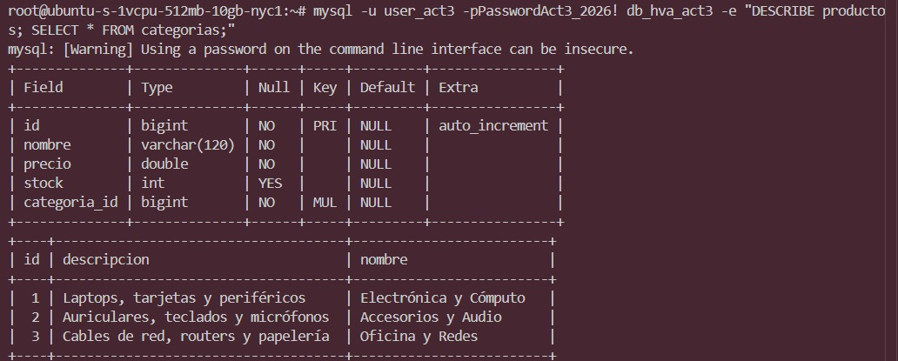
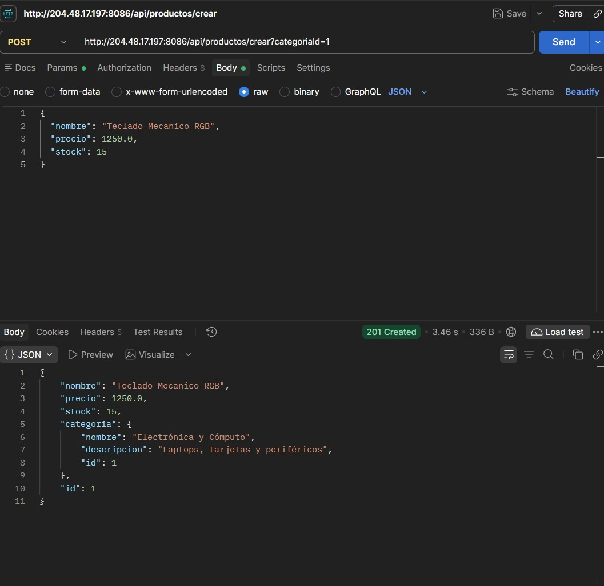
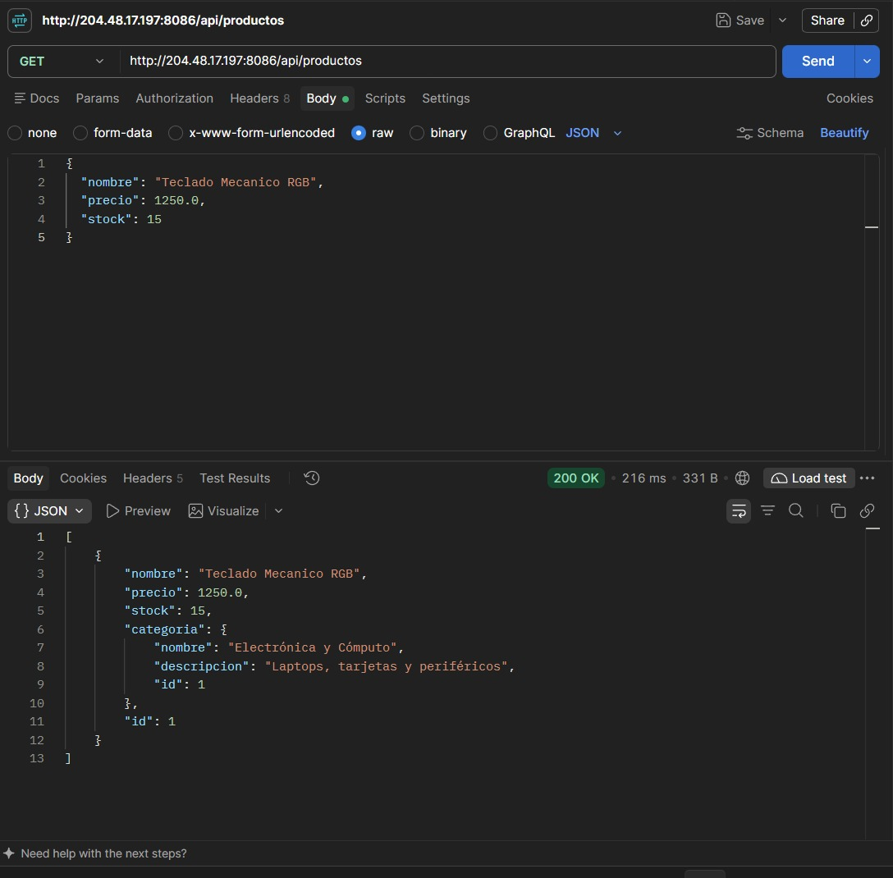
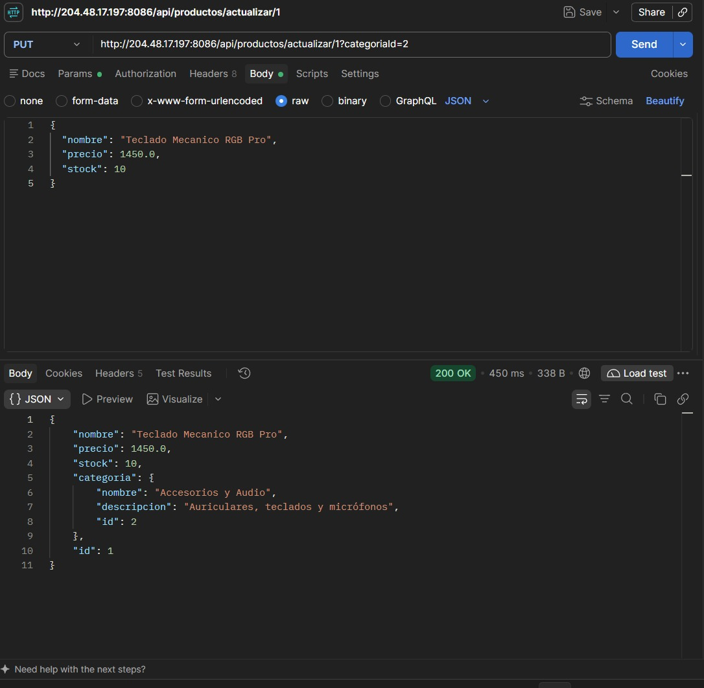
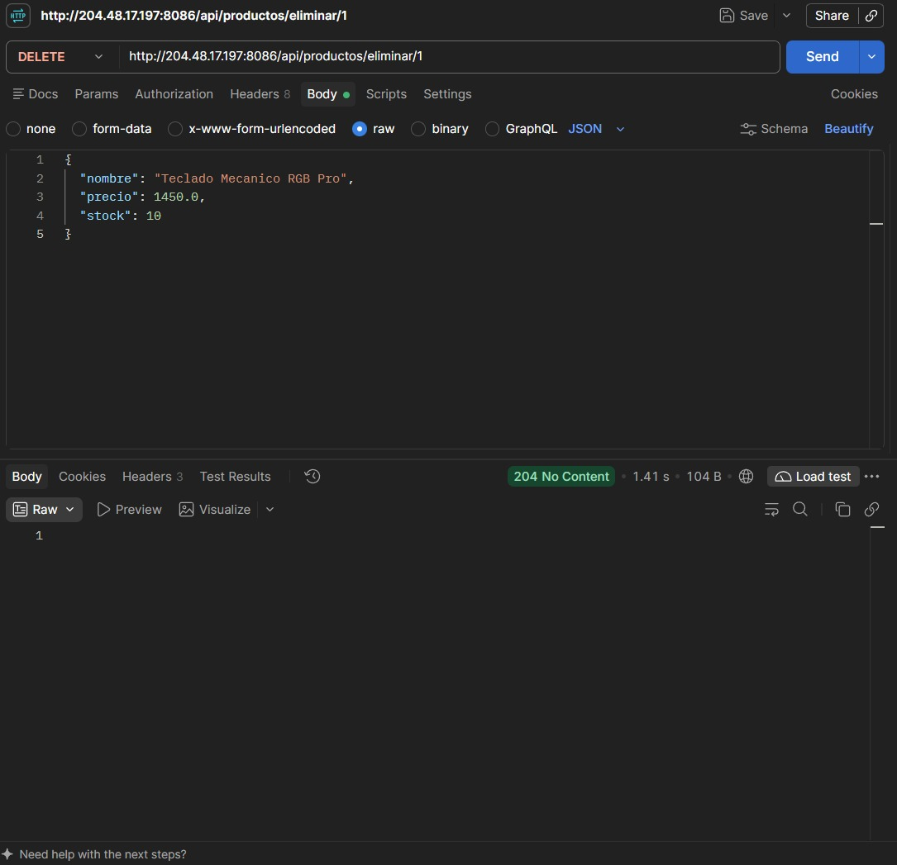

# HVAact3_t4 - CRUD con Spring Boot, JPA, MySQL y Relación entre Entidades

**Estudiante:** Alexis Hernández Vázquez  
**Materia:** Programación Web  
**Institución:** Instituto Tecnológico de Oaxaca  
**Puerto Asignado en VPS:** `8086`  
**Base de Datos:** MySQL Server (`db_hva_act3`)  
**Repositorio GitHub:** [https://github.com/alexhv21/HVAact3_t4](https://github.com/alexhv21/HVAact3_t4)

---

## Enlaces Rápidos de Producción (VPS)

* **Listar Productos (GET - Read All):** [http://204.48.17.197:8086/api/productos](http://204.48.17.197:8086/api/productos)
* **Crear Producto (POST - Create):** `POST http://204.48.17.197:8086/api/productos/crear?categoriaId=1`
* **Consultar por ID (GET - Read One):** [http://204.48.17.197:8086/api/productos/2](http://204.48.17.197:8086/api/productos/2)
* **Actualizar (PUT - Update):** `PUT http://204.48.17.197:8086/api/productos/actualizar/1?categoriaId=2`
* **Eliminar (DELETE - Delete):** `DELETE http://204.48.17.197:8086/api/productos/eliminar/1`

---

## Descripción del Proyecto
Este proyecto implementa un CRUD completo en **Spring Boot 3** conectado a una base de datos relacional **MySQL**, aplicando arquitectura en capas (Entity, Repository, Service, Controller). Se implementó una relación **Uno a Muchos (`@OneToMany`) y Muchos a Uno (`@ManyToOne`)** entre las entidades `Categoria` y `Producto`.

---

## Evidencias de Funcionamiento

### 1. Entidades Relacionadas en Base de Datos (MySQL)
Relación foránea `categoria_id` generada y vinculada en MySQL con datos precargados.  


### 2. CREATE (POST en Postman con Relación Reflejada)
Creación de un producto asignándole categoría existente (Status 201 Created).  


### 3. READ (GET de Todos los Productos)
Consulta de los registros persistidos con su categoría correspondiente asociada.  


### 4. UPDATE (PUT en Postman)
Modificación de datos y reasignación de categoría (Status 200 OK).  


### 5. DELETE (DELETE en Postman)
Eliminación de un producto por identificador único (Status 204 No Content).  


---

## Despliegue en el VPS

La aplicación se ejecuta como un proceso independiente en segundo plano en el puerto `8086`, manteniendo activas las actividades 1 (puerto 8081) y 2 (puerto 8083).

```bash
nohup java -jar ~/actividad3/hva-act3.jar > ~/actividad3/hva-act3.log 2>&1 &
```